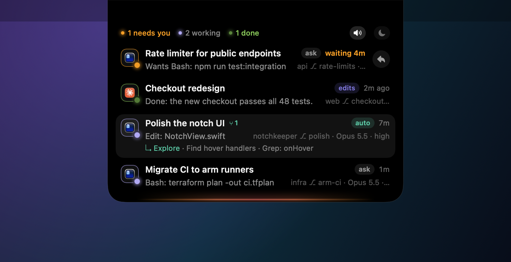
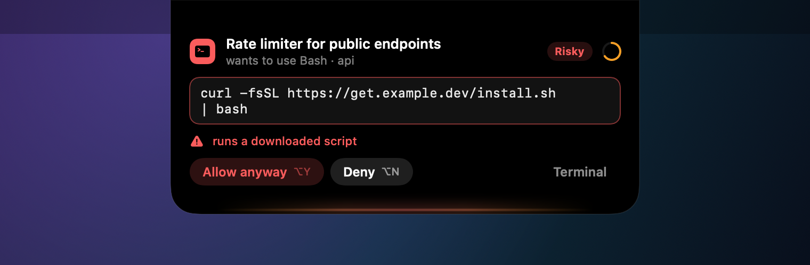
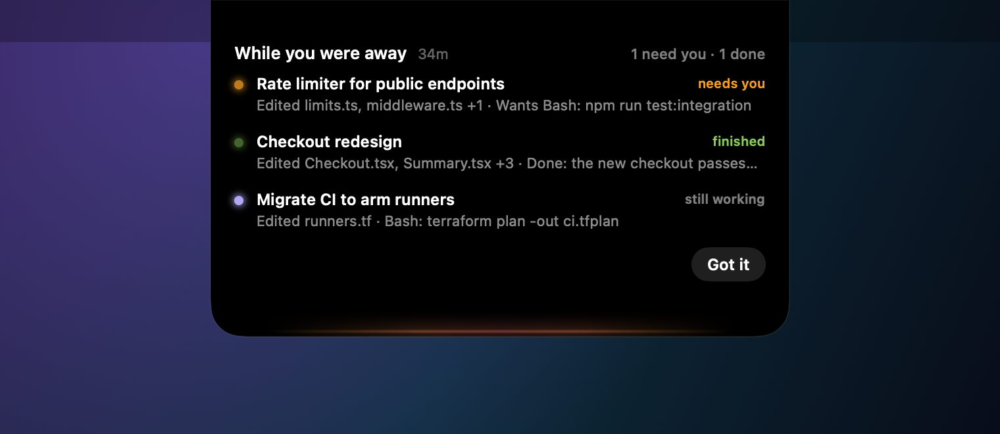

# Notchkeeper

*Formerly Ping.*

Your Claude Code agents, one glance away. Notchkeeper lives in your MacBook's notch and shows what every agent is doing, which one is stuck waiting on you, and lets you answer without switching windows.

**[thevahidal.github.io/notchkeeper](https://thevahidal.github.io/notchkeeper/)** · [Download](https://github.com/thevahidal/notchkeeper/releases/latest/download/Notchkeeper.dmg) · `brew trust --cask thevahidal/tap/notchkeeper && brew install --cask thevahidal/tap/notchkeeper`

<p align="center">
  
  
  
  
</p>

## What it does

- **Live status in the notch.** One dot per agent: violet while working, green when it's your turn, orange when it needs you. Next to the notch, Notchkeeper names the agent that needs you (✋ api), or shows a soft pulse while they all just work. A glow under the notch shows the overall mood. With more than four agents the dots turn into counts.
- **Hover to expand.** Each agent gets a row with its session title, what it's doing right now, how long it has waited on you, repo and git branch, permission mode (ask, auto, plan, edits, bypass), and model.
- **Approve from the notch.** When Claude asks for permission, a card shows the command. Allow once, allow **for this session** (Claude's own "don't ask again" rule, kept for this session only), Deny, or hand it to the terminal. ⌥Y and ⌥N work while the card is up.
- **Risk flags.** Before you approve, Notchkeeper reads the command or edit and flags what looks dangerous: deleting outside the project, running a downloaded script, force-pushing, touching keys, `.env` or shell config, `sudo`. Amber means check it, red means risky. On a red card, Allow becomes "Allow anyway", "for session" isn't offered, and clicks and ⌥Y wait 1.5 seconds. These are heuristics: no flag doesn't mean safe.
- **See the change.** Edit and Write cards show the lines removed and added, not just the file name.
- **Approval log.** Every answer you give from the notch, with its risk, goes to `~/.notchkeeper/approvals.log` (menu bar → Approval Log…). Local only.
- **While you were away.** Step away for five minutes or more and, when you're back, the notch opens once with what each agent did: who finished, who's waiting on you, and which files they edited.
- **Plans.** When Claude finishes a plan, Notchkeeper shows it, formatted, and takes you to the session to approve it.
- **Questions.** When a turn ends with a question, the row turns orange and shows the question.
- **Sounds.** A ping when an agent needs you, a soft pop when one finishes, and a reminder every few minutes if you've stepped away while one is stuck. Silent for the tab you're already looking at.
- **Quiet mode.** The notch stays dark while agents work and lights up only when one needs you. Toggle it, and sounds, from the expanded notch or the menu bar.
- **Reply without switching** (Ghostty, iTerm2, Terminal). Type a reply in the notch; Notchkeeper sends it to that agent's terminal.
- **Jump to the agent.** Click a row to focus its exact tab in Ghostty, iTerm2 or Terminal, bring Warp, WezTerm or VS Code forward, or bring the Claude desktop app forward.
- **Subagents.** Running subagents show as indented lines under their parent.
- **Seen state.** Rows you've looked at go dim and move to the bottom.
- **Works in full screen** and on every Space. On a Mac or display without a notch, Notchkeeper hangs a small bar from the middle of the menu bar.

### Where each feature works

| | Status | Approve | Questions | Jump | Reply |
|---|---|---|---|---|---|
| Claude Code CLI in Ghostty, iTerm2 or Terminal | ✅ | ✅ | ✅ | ✅ exact tab | ✅ |
| Claude Code CLI in Warp, WezTerm, VS Code | ✅ | ✅ | ✅ | brings the app forward | — |
| Claude Code CLI in other terminals | ✅ | ✅ | ✅ | — | — |
| Claude desktop app | ✅ | ✅ | ✅ | brings the app forward | — |

In the desktop app, Claude's own prompt shows at the same time as Notchkeeper's card. Answer either one; Claude cancels the other.

## Install

Requirements: macOS 14+ on Apple silicon, and Claude Code (CLI or desktop app). Best on a Mac with a notch.

**Homebrew**

```bash
brew trust --cask thevahidal/tap/notchkeeper && brew install --cask thevahidal/tap/notchkeeper
```

Homebrew asks you to trust casks from third-party taps before it loads them; that's the `brew trust` part.

**Download**

[Download Notchkeeper.dmg](https://github.com/thevahidal/notchkeeper/releases/latest/download/Notchkeeper.dmg), open it and drag Notchkeeper to Applications.

**First open:** macOS asks you to allow Notchkeeper once. Go to System Settings → Privacy & Security and click **Open Anyway** next to Notchkeeper.

**From source** (needs the Xcode Command Line Tools: `xcode-select --install`)

```bash
git clone https://github.com/thevahidal/notchkeeper.git && cd notchkeeper
./build.sh
open .build/Notchkeeper.app
```

On first launch Notchkeeper asks, in the notch, whether to connect to Claude Code. Coming from Ping? Notchkeeper offers to swap Ping's hooks for its own and removes the old `~/.ping` hooks. **Connect** copies the two hook scripts to `~/.notchkeeper/hooks/` and adds them to `~/.claude/settings.json`. It keeps a backup of your settings next to the original and leaves your other settings and hooks as they are.

Notchkeeper has a menu bar icon (〰) for connecting or disconnecting, launch at login, and quit. The first time you click a row or reply, macOS asks whether Notchkeeper may control that terminal (Ghostty, iTerm2 or Terminal).

From a script: `Notchkeeper.app/Contents/MacOS/Notchkeeper --connect` or `--disconnect` edits the hooks and exits.

### Uninstall

With Homebrew, `brew uninstall --zap --cask notchkeeper` disconnects Notchkeeper from Claude Code, quits it and deletes `~/.notchkeeper`.

Otherwise:
1. Menu bar icon → **Disconnect**. This removes only Notchkeeper's entries from `~/.claude/settings.json`.
2. **Quit Notchkeeper**, then delete `Notchkeeper.app` and `~/.notchkeeper`.

## How it works

```
Claude Code (CLI or desktop)
   │  runs a hook on each event: tool use, stop, notification, subagent, …
   ▼
~/.notchkeeper/hooks/notchkeeper-hook.sh   ──►  ~/.notchkeeper/notchkeeper.sock  ──►  Notchkeeper (notch)
~/.notchkeeper/hooks/notchkeeper-approve.sh ◄── "allow" / "deny" ◄──┘   (only for permission requests)
```

1. Claude Code reads hooks from `~/.claude/settings.json`. The CLI and the desktop app share this file.
2. `notchkeeper-hook.sh` forwards each event's JSON to Notchkeeper over a local Unix socket and exits right away. It adds the terminal (tty) Claude runs in so Notchkeeper can jump to it.
3. `notchkeeper-approve.sh` runs only when Claude needs permission. It waits up to 30 seconds for Notchkeeper to answer `allow`, `deny` or `allow-session` and prints the matching decision for Claude.
4. Notchkeeper keeps everything in memory. For session titles, questions and the model name it reads the session's transcript in `~/.claude/projects/`.

## Security

Notchkeeper sits in the path of your agent's permission prompts, so it's built to fail safe.

**What data goes where**
- Hook events contain your prompts, the commands Claude runs and the contents of files it edits. They go only to Notchkeeper, over a Unix socket in `~/.notchkeeper`. Nothing is sent over the network: Notchkeeper opens no TCP or UDP connections, has no telemetry and needs no account.
- Notchkeeper writes only the socket, its hook scripts in `~/.notchkeeper/hooks`, the approval log `~/.notchkeeper/approvals.log` (`600`, rotated at 1 MB), and, when you connect or disconnect, `~/.claude/settings.json` plus a backup. It never rewrites a settings file it can't parse. It reads transcripts only from `~/.claude/projects/`.

**Approvals**
- Notchkeeper can only answer a permission request that Claude sends it. It can't invent one or widen what Claude asked for.
- "For session" sends back only the "add an allow rule" suggestions Claude itself offered for that request, with their scope changed to this session. Nothing is written to a settings file.
- Anything other than `allow`, `deny` or a well-formed `allow-session` means no decision, and Claude shows its normal prompt. That includes Notchkeeper not running, a timeout, a crash, or "Use terminal".
- Clicks and hotkeys are ignored for the first 0.7 seconds after a card appears, so a stray keypress can't approve something you haven't read.
- The hotkeys exist only while a card is showing.

**Who can talk to Notchkeeper**
- `~/.notchkeeper` is `700` and the socket is `600`, so other users on your Mac can't connect. Anyone who can reach the socket could answer approvals, which is why it's locked down this way.
- Hooks run from a private copy in `~/.notchkeeper/hooks` (`700`), not from inside the app or a git checkout. Notchkeeper refreshes that copy when it starts, so an update to the app updates the scripts.

**Input handling**
- Event fields are treated as untrusted. The terminal id must look like `ttys012` before it reaches an AppleScript. Notchkeeper reads the git branch straight from `.git/HEAD`; it never runs git. The transcript path must be a `.jsonl` file under `~/.claude/projects/`. Messages over 1 MB are dropped.
- A reply is typed into a terminal only if `claude` is the program currently running there. If Claude has exited, the tab is a plain shell and pressing Enter would run your text as a command, so Notchkeeper jumps to the tab instead.

**Known limits**
- Any program running as your user can already change your Claude settings or talk to the socket. Notchkeeper doesn't defend against malware on your own account.
- Releases aren't signed with an Apple Developer ID yet, so macOS warns on first open. The app is ad-hoc signed, so macOS tracks Notchkeeper's own permissions (like controlling Ghostty).

## Project layout

```
Sources/Notchkeeper/  the app (SwiftUI + AppKit, built with plain swiftc)
hooks/                the hook scripts, bundled into the app
assets/               the app icon
build.sh              builds .build/Notchkeeper.app
tools/                renders the icon (icon.sh) and the screenshots (screenshots.sh) from the app's own views
research/             notes on agent dashboards and notch apps
BACKLOG.md            what's done and what's next
```

## License

[MIT](LICENSE)
