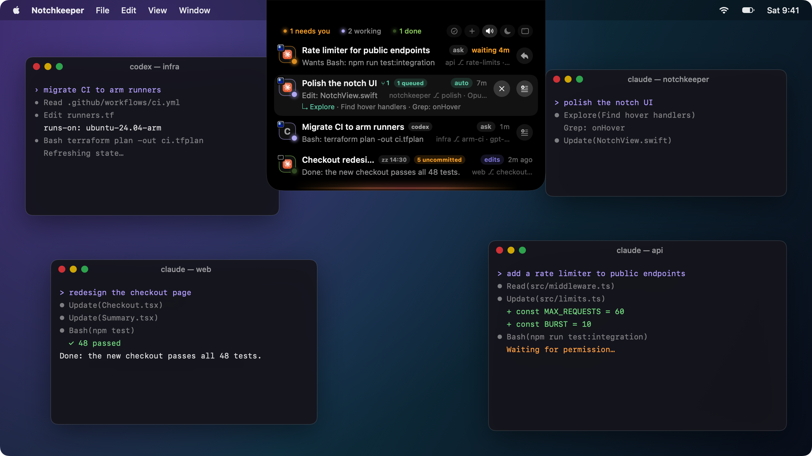
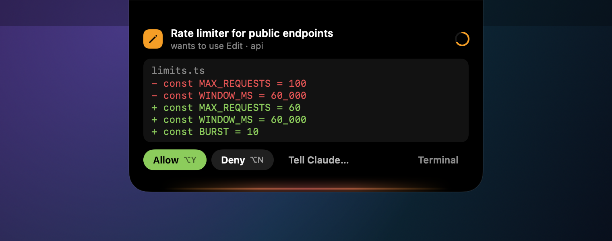
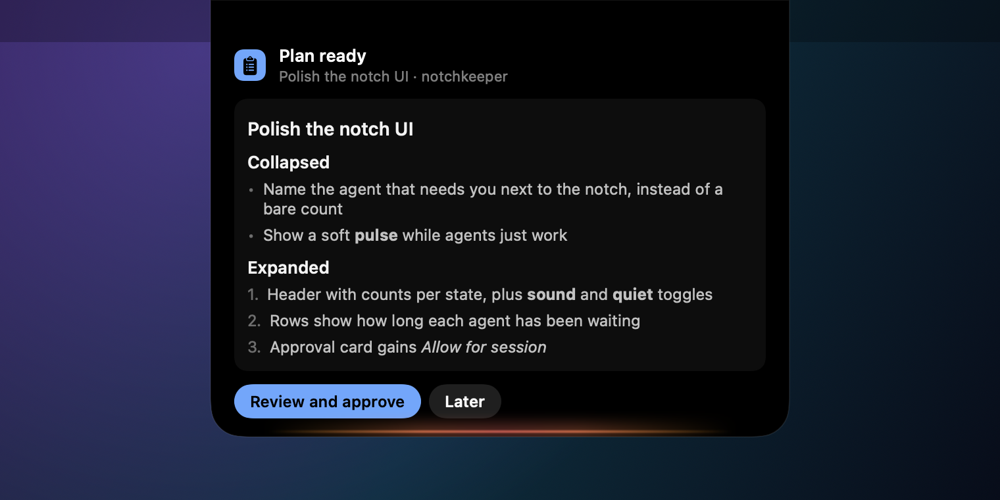

# Notchkeeper

Your coding agents, one glance away. Notchkeeper lives in your MacBook's notch and shows what every coding agent is doing (Claude Code, Codex, Gemini CLI, Cursor, Copilot CLI, Droid, Kiro, OpenCode and Mistral Vibe), which one is stuck waiting on you, and lets you answer without switching windows. Built for people juggling many things: nothing waiting on you gets lost.

**[thevahidal.github.io/notchkeeper](https://thevahidal.github.io/notchkeeper/)** · [Download](https://github.com/thevahidal/notchkeeper/releases/latest/download/Notchkeeper.dmg) · `brew trust --cask thevahidal/tap/notchkeeper && brew install --cask thevahidal/tap/notchkeeper`

<p align="center">
  
</p>

<table>
  <tr>
    <td width="50%"><br><sub>Risky commands are flagged before you approve</sub></td>
    <td width="50%"><br><sub>Edits show the lines removed and added</sub></td>
  </tr>
  <tr>
    <td><br><sub>What each agent did while you were away</sub></td>
    <td><br><sub>Plans, formatted, ready to review</sub></td>
  </tr>
</table>

## What it does

- **Live status in the notch.** One dot per agent: violet while working, green when it's your turn, orange when it needs you. Next to the notch, Notchkeeper names the agent that needs you (✋ api), or shows a soft pulse while they all just work. A glow under the notch shows the overall mood. With more than four agents the dots turn into counts.
- **Hover to expand.** Each agent gets a row with its session title, what it's doing right now, how long it has waited on you, repo and git branch, permission mode (ask, auto, plan, edits, bypass), and model.
- **Approve from the notch.** When Claude asks for permission, a card shows the command. Allow once, allow **for this session** (Claude's own "don't ask again" rule, kept for this session only), Deny, or hand it to the terminal. ⌥Y and ⌥N work while the card is up.
- **Risk flags.** Before you approve, Notchkeeper reads the command or edit and flags what looks dangerous: deleting outside the project, running a downloaded script, force-pushing, touching keys, `.env` or shell config, `sudo`. Amber means check it, red means risky. On a red card, Allow becomes "Allow anyway", "for session" isn't offered, and clicks and ⌥Y wait 1.5 seconds. These are heuristics: no flag doesn't mean safe.
- **See the change.** Edit and Write cards show the lines removed and added, not just the file name.
- **Approval log.** Every answer you give from the notch, with its risk, goes to `~/.notchkeeper/approvals.log` (menu bar → Approval Log…). Local only.
- **While you were away.** Step away for ten minutes or more and, when you're back, the notch opens once with what each agent did: who finished, who's waiting on you, and which files they edited. It stays quiet if nothing needs you, and you can change the wait or turn it off in Settings.
- **Start agents from the notch.** Click **+** (or menu bar → New Background Agent…), pick a folder, type what it should do. Notchkeeper runs `claude --bg`, optionally in its **own git worktree** so parallel agents don't collide. With tmux installed, you can pick Codex, Gemini CLI, Cursor or OpenCode instead (if connected): they run in a detached tmux session. The agent shows up like any other, tagged **bg**; click it to attach in a terminal.
- **Queue a follow-up.** While an agent works, type your next message into its row. Notchkeeper sends it when the turn ends, unless the turn ends with a question for you.
- **Tell Claude instead of just saying no.** On an approval card, **Tell Claude…** denies the call with your message ("use pnpm, not npm"), so the agent changes course instead of guessing.
- **Never lose track.** Agents waiting on you stay in the notch for a day, even if they go quiet, and come back after a restart or update. When you open Notchkeeper, a card lists what's still waiting.
- **Unsaved work.** When a turn ends, the row shows what's not saved in its folder (5 uncommitted · 2 unpushed), and clears once you commit and push. An agent that ends with unsaved work stays in the notch until it's saved or you close it.
- **Snooze.** Can't deal with it now? Hover a waiting agent and pick 15 minutes, 1 hour or tomorrow at 9. It goes quiet and comes back with a ping.
- **Gentle nudges.** If an agent has waited 10 minutes, Notchkeeper pings again every 10 minutes, or every 3 if you've stepped away.
- **Plans.** When Claude finishes a plan, Notchkeeper shows it, formatted, and takes you to the session to approve it.
- **Questions.** When a turn ends with a question, the row turns orange and shows the question.
- **Sounds.** A ping when an agent needs you, a soft pop when one finishes, and a reminder every few minutes if you've stepped away while one is stuck. Silent for the tab you're already looking at.
- **Quiet mode.** The notch stays dark while agents work and lights up only when one needs you. Toggle it, and sounds, from the expanded notch or the menu bar.
- **Chat history when you reply.** The reply card shows the last few turns of the conversation (Claude Code sessions), so you remember what you were talking about before you answer.
- **Reply without switching** (Ghostty, iTerm2, Terminal). Type a reply in the notch; Notchkeeper sends it to that agent's terminal.
- **Jump to the agent.** Click a row to focus its exact tab in Ghostty, iTerm2 or Terminal, bring Warp, WezTerm or VS Code forward, or bring the Claude desktop app forward.
- **Paste images.** ⌘V an image into a reply and the agent gets it as a file path.
- **Mark up the screen.** ⌃⌥D freezes the screen; draw on what you mean, press ↩, and ask a new background agent about it. Needs Screen Recording permission the first time.
- **Subagents.** Running subagents show as indented lines under their parent.
- **Seen state.** Rows you've looked at go dim and move to the bottom.
- **Works in full screen** and on every Space. On a Mac or display without a notch, Notchkeeper hangs a small bar from the middle of the menu bar. Turn on **Show on Active Display** in the menu bar to have it follow the screen you're working on, e.g. an external monitor.

### Where each feature works

**Agents**

| | Status | Approve | Questions | Plans |
|---|---|---|---|---|
| Claude Code (CLI and desktop app) | ✅ | ✅ | ✅ | ✅ |
| Codex CLI | ✅ | ✅ (no "for session") | — | — |
| Gemini CLI | ✅ | — (Gemini's hooks can't answer approvals) | — | — |
| Cursor (app and `cursor-agent`) | ✅ | — | — | — |
| Copilot CLI | ✅ | — | — | — |
| Droid (Factory) | ✅ | — | — | — |
| Kiro CLI (v3) | ✅ | — | — | — |
| OpenCode | ✅ | — | — | — |
| Mistral Vibe | ✅ | — | — | — |

The newer agents are status only, and approvals stay in the agent: none of them is hooked before a tool runs, where a failing hook would block the tool. Only OpenCode has been tried live so far; Cursor, Copilot, Droid, Kiro and Vibe follow their docs. Windsurf and Cline aren't supported: their hook docs don't describe a format we can rely on.

**Terminals** (jump to the exact pane, and reply)

| | Jump | Reply |
|---|---|---|
| Ghostty, iTerm2, Terminal | ✅ exact tab | ✅ |
| tmux (inside any terminal) | ✅ exact pane | ✅ |
| WezTerm | ✅ exact pane | ✅ |
| kitty (with `allow_remote_control` and `listen_on`) | ✅ exact window | ✅ |
| Warp, Alacritty, VS Code, Cursor, others | brings the app forward | — |
| Claude desktop app | brings the app forward | — |
| Background agents (`claude --bg`) | opens `claude attach` | — |

In the desktop app, Claude's own prompt shows at the same time as Notchkeeper's card. Answer either one; Claude cancels the other.

## Install

Requirements: macOS 14+ on Apple silicon, and Claude Code (CLI or desktop app). Best on a Mac with a notch.

**Homebrew**

```bash
brew trust --cask thevahidal/tap/notchkeeper && brew install --cask thevahidal/tap/notchkeeper
```

Homebrew asks you to trust casks from third-party taps before it loads them; that's the `brew trust` part.

**Download**

[Download Notchkeeper.dmg](https://github.com/thevahidal/notchkeeper/releases/latest/download/Notchkeeper.dmg), open it and drag Notchkeeper to Applications.

**First open:** macOS asks you to allow Notchkeeper once. Go to System Settings → Privacy & Security and click **Open Anyway** next to Notchkeeper.

**From source** (needs the Xcode Command Line Tools: `xcode-select --install`)

```bash
git clone https://github.com/thevahidal/notchkeeper.git && cd notchkeeper
./build.sh
open .build/Notchkeeper.app
```

On first launch Notchkeeper asks, in the notch, whether to connect to Claude Code. Coming from Ping? Notchkeeper offers to swap Ping's hooks for its own and removes the old `~/.ping` hooks. **Connect** copies the two hook scripts to `~/.notchkeeper/hooks/` and adds them to `~/.claude/settings.json`. It keeps a backup of your settings next to the original and leaves your other settings and hooks as they are.

**Settings** (menu bar icon 〰 → Settings…, or open the app again) is one window for everything: connect or disconnect each agent, sounds, quiet mode, which display, launch at login, plugins, the approval log and the `notchkeeper` command. It opens by itself the first time. Other agents show up under Agents when they're installed; click one to connect it. Codex runs new hooks only after you approve them, so open Codex and approve Notchkeeper's in `/hooks`. The first time you click a row or reply, macOS asks whether Notchkeeper may control that terminal (Ghostty, iTerm2 or Terminal).

From a script: `Notchkeeper.app/Contents/MacOS/Notchkeeper --connect [claude|codex|gemini|cursor|copilot|droid|kiro|opencode|vibe]` or `--disconnect [agent]` edits the hooks and exits.

### Uninstall

With Homebrew, `brew uninstall --zap --cask notchkeeper` disconnects Notchkeeper from Claude Code, quits it and deletes `~/.notchkeeper`.

Otherwise:
1. Menu bar icon → uncheck each agent under **Agents**. This removes only Notchkeeper's entries from that agent's settings.
2. **Quit Notchkeeper**, then delete `Notchkeeper.app` and `~/.notchkeeper`.

## Extend it

- **Anything in the notch.** `~/.notchkeeper/bin/notchkeeper run -- npm run build` shows the build while it runs and pings when it's done or fails. `notchkeeper notify --id … --title … --state done --url …` posts anything else: deploys, CI, long scripts.
- **Plugins.** Small scripts that run when an agent needs you, finishes or asks for approval. Three come with the app, all off until you turn them on in Settings or the menu bar:
  - **Say it**: speaks "api needs you", in the voice you pick.
  - **Journal**: a daily Markdown log of what your agents did, in `~/.notchkeeper/journal/`.
  - **Phone (ntfy)**: pushes "needs you" and "done" to your phone and watch through [ntfy](https://ntfy.sh). Turn it on and set a hard-to-guess topic under it in Settings. Only the agent's title leaves your Mac.

  A plugin can declare its own settings; they show up under it in Settings once it's on, and it works on its defaults if you never touch them.
- **Build your own** on the socket protocol: see [PROTOCOL.md](PROTOCOL.md). It's also the starting point for a Linux client.

## How it works

```
Claude Code / Codex / Gemini CLI / Cursor / Copilot / Droid / Kiro / OpenCode / Vibe
   │  runs a hook on each event: tool use, stop, notification, subagent, …
   ▼
~/.notchkeeper/hooks/notchkeeper-hook.sh   ──►  ~/.notchkeeper/notchkeeper.sock  ──►  Notchkeeper (notch)
~/.notchkeeper/hooks/notchkeeper-approve.sh ◄── "allow" / "deny" ◄──┘   (only for permission requests)
```

1. Claude Code reads hooks from `~/.claude/settings.json` (the CLI and the desktop app share it), Codex from `~/.codex/hooks.json`, Gemini CLI from `~/.gemini/settings.json`, Cursor from `~/.cursor/hooks.json`, Droid from `~/.factory/hooks.json` (or `settings.json`), Vibe from `~/.vibe/hooks.toml` (in a marked block). Copilot, Kiro and OpenCode get a file of Notchkeeper's own: `~/.copilot/hooks/notchkeeper.json`, `~/.kiro/hooks/notchkeeper.json`, `~/.config/opencode/plugins/notchkeeper.js` (a small plugin that sends OpenCode's events through the same hook script).
2. `notchkeeper-hook.sh` forwards each event's JSON to Notchkeeper over a local Unix socket and exits right away. It adds where the agent runs (tty, terminal app, tmux / WezTerm / kitty pane) so Notchkeeper can jump to it.
3. `notchkeeper-approve.sh` runs only when Claude needs permission. It waits up to 30 seconds for Notchkeeper to answer `allow`, `deny` or `allow-session` and prints the matching decision for Claude.
4. Notchkeeper keeps sessions in memory and in `~/.notchkeeper/sessions.json`, so they survive a restart. For Claude's session titles, questions and model it reads the transcript in `~/.claude/projects/`.

## Security

Notchkeeper sits in the path of your agent's permission prompts, so it's built to fail safe.

**What data goes where**
- Hook events contain your prompts, the commands Claude runs and the contents of files it edits. They go only to Notchkeeper, over a Unix socket in `~/.notchkeeper`. Nothing is sent over the network: Notchkeeper opens no TCP or UDP connections, has no telemetry and needs no account.
- Notchkeeper writes only the socket, its hook scripts in `~/.notchkeeper/hooks`, the approval log `~/.notchkeeper/approvals.log` and the activity log `~/.notchkeeper/activity.log` (both `600`, rotated at 1 MB; turn the activity log off in Settings), the saved session list `~/.notchkeeper/sessions.json` (`600`; it holds titles and recent activity), and, when you connect or disconnect an agent, that agent's settings file (listed under How it works) plus a backup, or the file of Notchkeeper's own for Copilot, Kiro and OpenCode. It never rewrites a settings file it can't parse. It reads transcripts only from `~/.claude/projects/`.

**Approvals**
- Notchkeeper can only answer a permission request that Claude sends it. It can't invent one or widen what Claude asked for.
- "For session" sends back only the "add an allow rule" suggestions Claude itself offered for that request, with their scope changed to this session. Nothing is written to a settings file.
- Anything other than `allow`, `deny` or a well-formed `allow-session` means no decision, and Claude shows its normal prompt. That includes Notchkeeper not running, a timeout, a crash, or "Use terminal".
- Clicks and hotkeys are ignored for the first 0.7 seconds after a card appears, so a stray keypress can't approve something you haven't read.
- The hotkeys exist only while a card is showing.

**Who can talk to Notchkeeper**
- `~/.notchkeeper` is `700` and the socket is `600`, so other users on your Mac can't connect. Anyone who can reach the socket could answer approvals, which is why it's locked down this way.
- Hooks run from a private copy in `~/.notchkeeper/hooks` (`700`), not from inside the app or a git checkout. Notchkeeper refreshes that copy when it starts, so an update to the app updates the scripts.

**Input handling**
- Pane ids from the hook (tmux, WezTerm, kitty) must match their exact shape before Notchkeeper uses them, and `tmux`, `wezterm` and `kitten` run with arguments, never through a shell. Replies are sent as literal text.
- Plugins are off until you turn each one on. A plugin's script must sit inside its own folder, runs without a shell, gets 10 seconds, and receives only the event JSON. A plugin can send data off your Mac (the ntfy example does, by design), so turn on only what you trust.
- `notchkeeper notify` links open only if they're `http(s)`.
- Starting an agent runs the `claude` executable directly with your prompt as an argument, never through a shell, so nothing in the prompt can run as a command.
- Event fields are treated as untrusted. The terminal id must look like `ttys012` before it reaches an AppleScript. Notchkeeper reads the git branch straight from `.git/HEAD`; it never runs git. The transcript path must be a `.jsonl` file under `~/.claude/projects/`. Messages over 1 MB are dropped.
- A reply is typed into a terminal only if `claude` is the program currently running there. If Claude has exited, the tab is a plain shell and pressing Enter would run your text as a command, so Notchkeeper jumps to the tab instead.

**Known limits**
- Any program running as your user can already change your Claude settings or talk to the socket. Notchkeeper doesn't defend against malware on your own account.
- Releases aren't signed with an Apple Developer ID yet, so macOS warns on first open. The app is ad-hoc signed, so macOS tracks Notchkeeper's own permissions (like controlling Ghostty).

## Project layout

```
Sources/Notchkeeper/  the app (SwiftUI + AppKit, built with plain swiftc)
hooks/                the hook scripts, bundled into the app
plugins/              example plugins, bundled into the app
PROTOCOL.md           the socket protocol, for plugins, items and ports
assets/               the app icon
build.sh              builds .build/Notchkeeper.app
tools/                renders the icon (icon.sh) and the screenshots (screenshots.sh) from the app's own views
research/             notes on agent dashboards and notch apps
BACKLOG.md            what's done and what's next
```

## License

[MIT](LICENSE)
